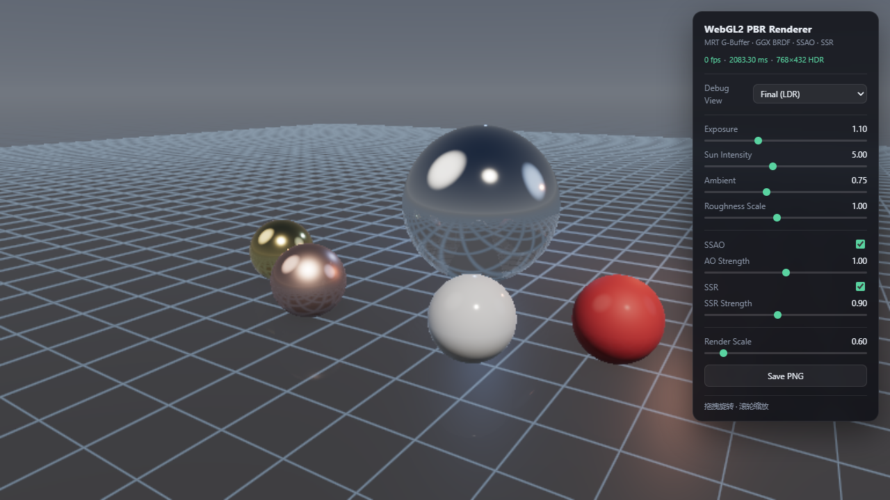
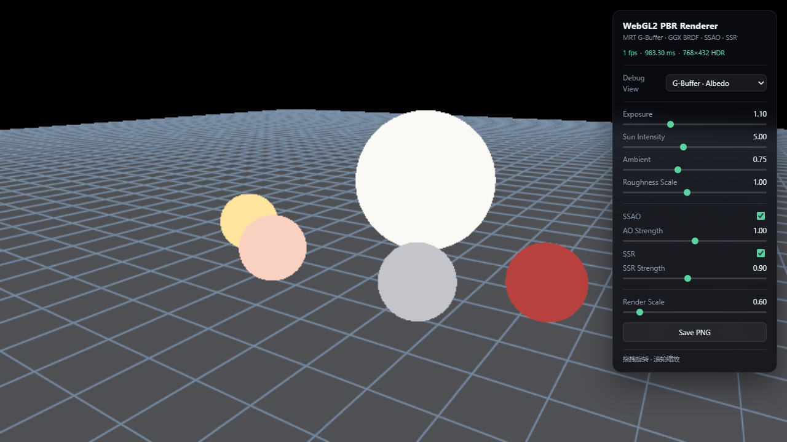
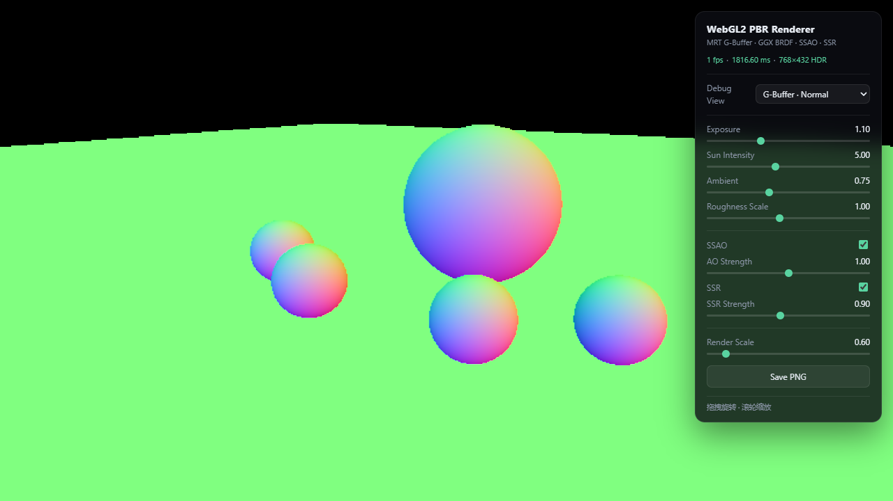
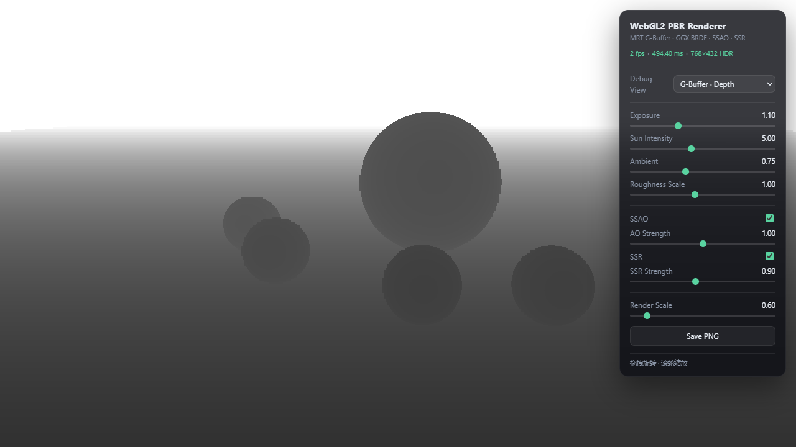
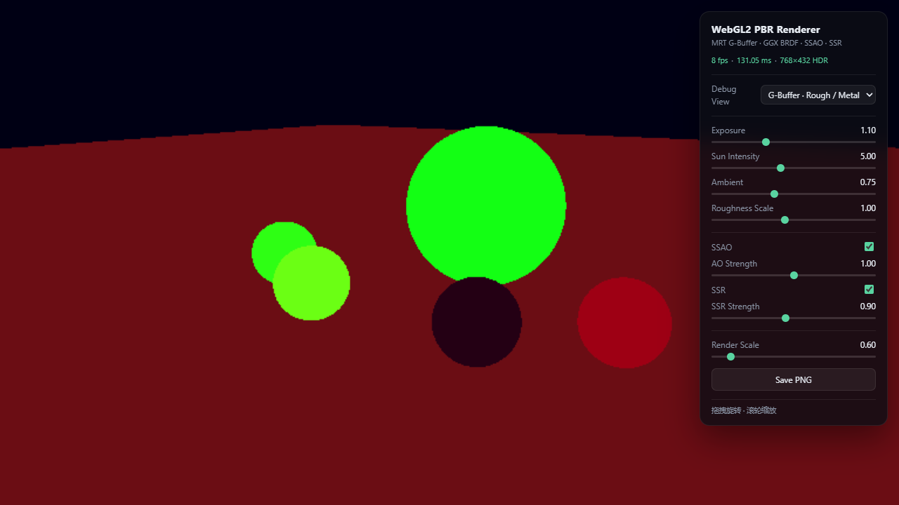
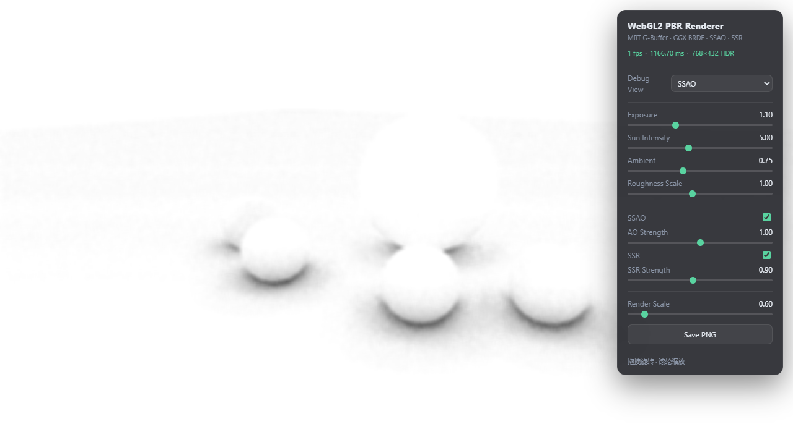
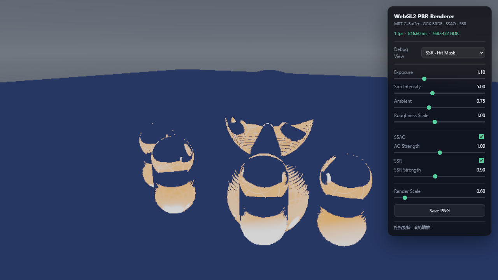

# WebGL2 Real-Time PBR Renderer

基于 WebGL2 的实时**延迟渲染**演示：MRT G-Buffer、GGX/Smith/Schlick Cook-Torrance BRDF、SSAO、屏幕空间反射（SSR）、ACES 色调映射，全部零依赖手写 GLSL ES 3.00。

> 一个可以直接在浏览器里跑、可以逐帧看到 G-Buffer 数据、可以读源码的项目，而不是几个孤立的 shader 片段。

**在线演示**：https://jashd9528.github.io/webgl2-pbr-renderer/
**仓库**：https://github.com/jashd9528/webgl2-pbr-renderer



---

## 1. 它做了什么

| 能力 | 实现位置 | 说明 |
|---|---|---|
| WebGL2 上下文与能力探测 | `src/core/Renderer.js` | 探测 `EXT_color_buffer_float`，不支持时自动回退 RGBA8 |
| MRT 多渲染目标 G-Buffer | `src/rendering/GBuffer.js` | 2×RGBA16F + RGBA8(ID) + DEPTH24 纹理，`gl.drawBuffers` |
| 几何 Pass | `src/rendering/GeometryPass.js` | 世界空间法线、材质参数写入 G-Buffer |
| 延迟光照 Pass | `src/rendering/LightingPass.js` | 由深度反投影重建视空间坐标，Cook-Torrance 着色 |
| GGX 法线分布 / Smith 遮蔽 / Schlick 菲涅尔 | `src/shaders/lighting.frag` | 与 `src/math/BRDF.js` 的 CPU 版本逐项对应 |
| SSAO + 模糊 | `src/rendering/SSAOPass.js` | 32 半球核、切线基随机旋转、深度比较、5×5 box blur |
| 屏幕空间反射 | `src/rendering/SSRPass.js` | 视空间射线步进 + 二分细化 + Object-ID 自相交拒绝 |
| ACES + sRGB | `src/shaders/tonemap.frag` | ACES fitted 曲线、曝光控制 |
| G-Buffer 可视化 | `src/shaders/tonemap.frag` | 6 种调试视图，见下 |
| 材质 / 光照 / 性能面板 | `index.html` + `src/main.js` | 曝光、太阳强度、环境光、粗糙度、AO/SSR 开关与强度、渲染分辨率缩放、FPS |

### 调试视图

下拉框可在「最终画面」和 G-Buffer 各通道之间切换，用来证明管线每一级输入输出都正确：

| 视图 | 内容 |
|---|---|
| G-Buffer · Albedo | `color0.rgb`（线性空间反 gamma 显示） |
| G-Buffer · Normal | 世界空间法线 `color1.rgb` 映射到 0..1 |
| G-Buffer · Depth | 深度缓冲线性化后可视化 |
| G-Buffer · Rough / Metal | R = 粗糙度，G = 金属度 |
| SSAO | 乘进环境项之前的遮蔽因子 |
| SSR · Hit Mask | 橙色 = 命中，深蓝 = 未命中 |

| Albedo | Normal |
|---|---|
|  |  |

| Depth | Roughness / Metallic |
|---|---|
|  |  |

| SSAO | SSR Hit Mask |
|---|---|
|  |  |

---

## 2. 运行

### 方式 A：Vite（推荐）

```bash
npm install
npm run dev
# 打开 http://127.0.0.1:5180
```

### 方式 B：零依赖静态服务

项目运行时不依赖任何第三方库，`npm install` 只用于拿到 Vite 开发服务器：

```bash
python -m http.server 5399 --bind 127.0.0.1
# 打开 http://127.0.0.1:5399/index.html
```

> 必须通过 HTTP 打开，`file://` 下 `fetch()` 读取 GLSL 会被 CORS 拦截。

### 操作

- 鼠标拖拽：环绕旋转
- 滚轮：推拉镜头
- 面板：所有参数实时生效，「Save PNG」导出当前帧

---

## 3. 渲染管线

```
Scene（球体 / 地面 / 方向光 + 2 点光）
        │
        ▼
Geometry Pass ──► G-Buffer
                  color0: albedo.rgb + metallic
                  color1: worldNormal.rgb + roughness
                  color2: objectId
                  depth : DEPTH24
        │
        ├──► SSAO ──► Blur ──► AO(R8)
        │
        ▼
Lighting Pass（深度反投影 + Cook-Torrance + 解析环境光）──► HDR(RGBA16F)
        │
        ▼
SSR Pass（视空间步进 + 二分细化 + Object-ID 拒绝）──► HDR2
        │
        ▼
Tonemap Pass（ACES + sRGB + 调试视图）──► Canvas
```

每帧 6 个 draw call 级别的 Pass（几何 Pass 内 6 个物体），无后处理链以外的中间拷贝。

---

## 4. 几个值得说的实现细节

**深度反投影**
只存硬件深度，不存 G-Buffer 位置，省一个 RGBA16F 附件。光照/SSAO/SSR 共用同一段重建代码：

```glsl
vec4 clip = vec4(uv * 2.0 - 1.0, depth * 2.0 - 1.0, 1.0);
vec4 view = uInvProj * clip;
vec3 viewPos = view.xyz / view.w;
```

**SSAO 的深度比较方向**
视空间 Z 为负，所以「更靠近相机」意味着 Z 更大。遮蔽判定必须写成
`sceneZ >= sampleZ + bias`，写成 `<=` 会让平面被判定成完全遮蔽（本项目开发期真实踩过这个坑，见 `docs/verification.md`）。同时用 3D 距离硬性剔除采样球之外的遮挡体，否则屏幕空间投影会把远处几何算进来。

**SSR 的 Object-ID 拒绝**
屏幕空间追踪最典型的错误是「凸面镜反射自己」：射线在球面上出发，投影后又在球体自身的像素上判定命中，采到球体背面的暗色，形成黑色尖角状伪影。G-Buffer 第三个附件存 `objectId`，命中点与起点同 ID 直接丢弃。另外做了：法线背向拒绝、最小步进距离、二分细化、边缘淡出、掠射角加权。

**解析环境光的抗锯齿**
金属球没有真实 cubemap 可采，环境用一个解析函数：天空梯度 + 虚拟地面平面（复刻场景网格）+ 两块柔光箱。镜面反射相邻像素采样方向差异极大，程序化网格会走样成噪点，因此线宽用 `fwidth(uv)` 自适应加宽——和纹理 mipmap 是同一个思路的解析版本。

**CPU/GPU 双份 BRDF**
`src/math/BRDF.js` 用 JS 复刻了 `D_GGX` / `G_Smith` / `FresnelSchlick`，用于数值对照和单元测试，避免「shader 里写错了但肉眼看不出」。

---

## 5. 项目结构

```text
webgl2-pbr-renderer/
├── index.html                 # 画布 + 控制面板
├── package.json
├── vite.config.js
├── src/
│   ├── main.js                # 装配、UI、主循环
│   ├── style.css
│   ├── core/
│   │   ├── Renderer.js        # 上下文、扩展、全屏三角形、计时
│   │   ├── Camera.js          # 轨道相机 + 逆矩阵
│   │   ├── Shader.js          # 编译/链接/Uniform 缓存
│   │   └── Framebuffer.js     # 多附件 FBO + 深度纹理
│   ├── shaders/
│   │   ├── geometry.vert/.frag
│   │   ├── fullscreen.vert
│   │   ├── lighting.frag
│   │   ├── ssao.frag
│   │   ├── ao_blur.frag
│   │   ├── ssr.frag
│   │   ├── tonemap.frag
│   │   └── index.js           # GLSL 加载与编译
│   ├── rendering/
│   │   ├── GBuffer.js
│   │   ├── GeometryPass.js
│   │   ├── LightingPass.js
│   │   ├── SSAOPass.js
│   │   ├── SSRPass.js
│   │   └── TonemapPass.js
│   ├── materials/PBRMaterial.js
│   ├── math/
│   │   ├── mat4.js
│   │   ├── vec3.js
│   │   └── BRDF.js
│   └── scene/
│       ├── Scene.js           # 场景装配 + 灯光动画
│       ├── Sphere.js          # UV 球生成
│       ├── Plane.js
│       └── Light.js
├── docs/
│   ├── architecture.md
│   ├── rendering-pipeline.md
│   ├── verification.md        # 实测记录（含截图与数据）
│   └── screenshots/
└── README.md
```

---

## 6. 验证状态

- 无控制台报错、无 shader 编译失败（headless Chromium + SwiftShader 实测，记录见 `docs/verification.md`）
- 6 个调试视图均输出互不相同的图像，证明 G-Buffer 每一路都在被写入
- 软件光栅化下约 2 fps（SSAO 32 采样 × SSR 52 步进是纯算力开销）；真实 GPU 上该分辨率无压力，面板右上角有实时帧时
- `EXT_color_buffer_float` 缺失时自动回退 RGBA8，HUD 会显示是否处于 HDR 路径

---

## 7. 后续可做

- 局部 cubemap 反射探针（把其他球体也反射进镜面球）
- 阴影贴图 / 接触阴影
- TAA + 运动向量
- Bloom / 景深
- 材质纹理与法线贴图管线

## License

MIT
